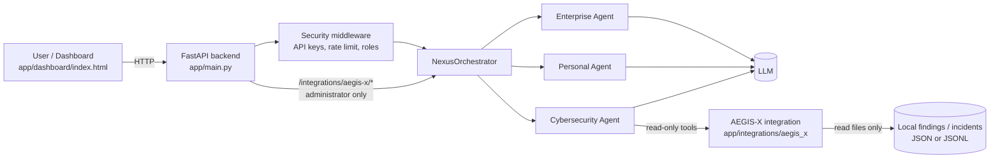

# NEXUS AI: Project Showcase

**NEXUS AI — Unified Enterprise, Personal Assistant & Cybersecurity AI Platform**

NEXUS AI is a unified multi-agent AI platform. Three specialized agents are coordinated through
one FastAPI backend and one web dashboard, so a user can talk to the right agent, or to all of
them, from a single interface. It also includes a **read-only** security-operations view that
reads normalized findings from the AEGIS-X multi-cloud security platform.

> **Status:** an engineering project and demonstration. It is **not production-ready**. See
> [RELEASE_READINESS.md](RELEASE_READINESS.md) for what has and has not been checked.

## Three specialized agents

| Agent | Focus |
|---|---|
| **Enterprise AI** | Business analysis, strategic planning, documents and operations. |
| **Personal AI** | Personal planning, productivity and everyday assistance. |
| **Cybersecurity AI** | Security analysis, threat assessment and defensive recommendations. |

The dashboard offers two unified interaction options on top of the individual agents:

- **NEXUS Auto — Conversation Intelligence:** a single conversational entry point that works out
  the intent of the message and responds or routes accordingly.
- **All Three Agents:** runs a coordinated team workflow (Enterprise, then Personal, then
  Cybersecurity). Each agent's output is passed to the next as bounded, explicitly untrusted
  context, and a decision engine combines the results into one report.

## AEGIS-X Security Operations Center

The dashboard includes an **AEGIS-X Security Operations Center** section that presents normalized
security findings and correlated incidents produced by AEGIS-X.

- **Findings explorer:** a table of findings with finding ID, cloud, severity, resource, title,
  timestamp and status.
- **Cloud filtering:** All, AWS, Azure, GCP.
- **Severity filtering:** All, Critical, High, Medium, Low.
- **Incident visibility and details:** incident ID, risk score, highest severity, number of
  correlated findings, clouds involved and MITRE ATT&CK techniques, with a detail view showing why
  AEGIS-X grouped the findings, a timeline and the evidence.
- **Risk explanations:** "Explain risk" on a finding separates *confirmed facts* (recorded in the
  finding), *inferred risk* (an assessment, not a confirmed compromise) and *unknowns*.
- **Evidence correlation:** select findings and see shared resources, accounts, techniques and
  evidence references. Shared attributes are reported as *possible relation only*, never as proof
  of causation.
- **Text-based defensive recommendations:** informational suggestions only.
- **Integration status and data provenance:** shows the integration mode, how many findings and
  incidents were loaded, how many records were quarantined as invalid, and a banner stating whether
  the data is declared **DEMO** or **LIVE** by the operator (see Security design).
- **Operator authentication and connection controls:** Connect, Disconnect and Refresh. The operator
  key is entered in a password field and kept in browser memory only.

### The integration is read-only

NEXUS **does not execute cloud changes or remediation**. It loads findings from a local directory,
validates them, and produces text and data. It imports no cloud SDK, makes no cloud API calls,
receives no cloud credentials, and does not write to AEGIS-X data. Recommendations are advice for a
human operator; nothing is executed. Automated tests assert these properties (no cloud SDK or
network imports, no write or execution calls, no mutating routes). Requirements that would have to
be met before any response execution could exist are documented in
[aegis-x-integration.md](aegis-x-integration.md).

## Architecture



- **FastAPI backend** (`app/main.py`): exposes the chat, agent, team and system routes and serves
  the dashboard.
- **NexusOrchestrator** (`app/core/orchestrator.py`): validates input, dispatches to agents, records
  activity metrics, and runs the three-agent team workflow. AEGIS-X tool calls are routed through it
  to the Cybersecurity agent.
- **Enterprise, Personal and Cybersecurity agents** (`app/agents/`): each calls the language model
  with a domain-specific, defensive system prompt.
- **AEGIS-X integration** (`app/integrations/aegis_x/`): a local-file loader that validates records
  and quarantines invalid ones, plus an allowlisted set of read-only tools (query findings, list and
  summarize incidents, correlate evidence, explain risk, recommend actions as text).
- **Dashboard** (`app/dashboard/index.html`): a single page with the chat/agents panel and the SOC
  section.

## Security design

- **Operator API key authentication:** the operator credential (`NEXUS_API_KEY`) is accepted as
  `X-API-Key` or `Authorization: Bearer`. Keys are never hardcoded in the page.
- **Scoped-user boundaries:** scoped user keys (`NEXUS_API_KEYS`) reach agent and chat routes and are
  confined to their own user data, but are refused (403) on system-level routes.
- **Administrator-only AEGIS-X routes:** every `/integrations/aegis-x/*` route requires the
  administrator principal, because findings are deployment-wide data. Without a key the response is
  401; with a scoped-user key it is 403.
- **Browser handling of the key:** held in JavaScript memory only, never written to localStorage or
  sessionStorage, cleared from the input once captured, and discarded on Disconnect or page hide.
- **Read-only security integration:** see above; enforced by guard tests.
- **Evidence-based reporting and uncertainty:** every AEGIS-X response cites the `finding_id` and
  `native_id` it relies on and lists what is unknown (missing resource or evidence fields, ids that
  were not found, quarantined records, empty results, correlation versus causation). The tools are
  deterministic and do not call a language model, so they do not invent facts.
- **Demo versus live labeling:** NEXUS cannot tell fixture data from live telemetry, so the operator
  declares it with `NEXUS_AEGIS_X_DATA_LABEL=demo|live`. `demo` shows a "DEMO DATA: test fixtures,
  not live cloud telemetry" banner. If unset, the dashboard warns that the data source is not
  declared and must not be assumed live. A `live` label is a claim by the operator that NEXUS
  cannot verify.
- **Untrusted content:** inter-agent output and finding contents are treated as untrusted data, not
  instructions.

This describes the design and what was tested locally. It is not a claim of production readiness or
of a completed security audit.

## Demonstration walkthrough

Start the server (use an ASCII-only key of your own choosing):

```bash
NEXUS_API_KEY="<your-ascii-key>" NEXUS_AEGIS_X_DATA_DIR="$PWD/tests/fixtures/aegis_x" NEXUS_AEGIS_X_DATA_LABEL=demo .venv/bin/python -m uvicorn app.main:app --port 8001
```

1. Open the NEXUS dashboard at `http://localhost:8001/`.
2. Select **Enterprise AI** and submit a business request (for example, a short market-entry
   analysis).
3. Select **Personal AI** and submit a productivity request (for example, a weekly study plan).
4. Select **Cybersecurity AI** and submit a security analysis request (for example, how to triage a
   suspicious login alert).
5. Scroll to **AEGIS-X Security Operations Center**, enter the operator key and press **Connect**.
   Confirm the DEMO DATA banner.
6. Explore **findings** (try the cloud and severity filters) and **incidents** (open Details).
7. Press **Explain risk** on a finding and compare confirmed facts, inferred risk and unknowns.
8. Select two or more findings and press **Correlate selected evidence**.
9. Select findings and press **Recommendations for selected**; note the informational-only notice.

Note: when authentication is enabled, the original chat/agents panel does not send an API key, so
it works only when authentication is off. The SOC section has its own Connect control.

## Verification results

Checked on a local server using the bundled AEGIS-X demo fixtures and temporary keys. These are
local checks of fixture data, not a production deployment and not live cloud telemetry.

| Check | Result |
|---|---|
| Dashboard `GET /` | HTTP 200, SOC section present |
| AEGIS-X route with no credentials | 401 |
| AEGIS-X route with a scoped-user key | 403 |
| AEGIS-X route with the operator key | 200 via `X-API-Key` and via `Authorization: Bearer` |
| AEGIS-X status | `read-only`, data label `demo` |
| Fixture contents | 4 findings, 1 incident |
| Enterprise, Personal and Cybersecurity agents | Each returned 200 with a model reply |
| `/chat` | 200 with a model reply |
| Automated test suite at the time of the SOC dashboard merge | 437 passed, 1 skipped |

Not verified: behavior against real AEGIS-X pipeline output or live cloud data, and deployment under
untrusted multi-user exposure.
